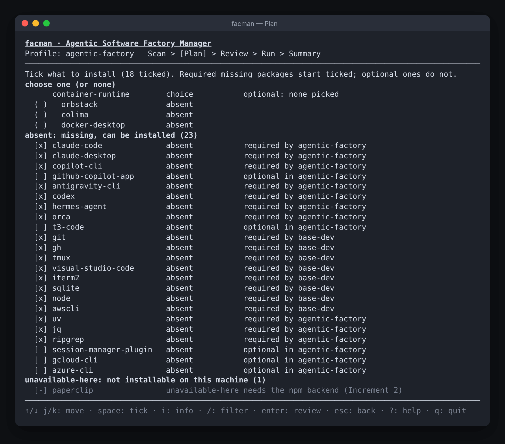

# software-factory-manager

**Agentic Software Factory Manager** — the home of `facman`.

[](https://github.com/stainedhead/software-factory-manager/actions/workflows/ci.yml)

> **Status:** Increment 1 (MVP) is built: the TUI (`facman`) and the headless commands `scan`, `plan`, `apply`, `status` and `doctor`, each with `--json`, on macOS, Linux and WSL 2 through Homebrew. Upgrades, uninstall, adoption, the npm backend, configuration lists (`-cl`), templates and per-tool setup flags arrive in later increments; see [What works today](#what-works-today). The Increment 1 spec is archived at [specs/archive/261114-software-factory-manager/](specs/archive/261114-software-factory-manager/).

## Overview

`software-factory-manager` builds **`facman`**, the **Agentic Software Factory Manager**: a terminal UI and headless CLI that gives lab machines and CI runners a consistent toolset for working in software factories.

`facman` is built on four principles:

- **Detect first.** It finds what is already installed, and how it got there (Homebrew, a vendor installer, npm, the OS, a version manager).
- **Propose only what is missing.** Existing installations are respected, never overwritten.
- **Ask before changing anything.** Every command is shown in full, in order, before you consent.
- **Manage only what it installed.** Each package has an explicit ownership state, and tools it did not install are reported, not changed, unless you adopt them.

It installs through Homebrew (macOS, Linux and WSL 2) and, in a later increment, npm. Build machines get the same tools with no prompts from a checked-in configuration list.

The repository is named for what the product is, a software factory manager. The binary is `facman`, and both `facman --version` and `facman --about` print the full name, "Agentic Software Factory Manager". For purpose, audience, scope and key decisions, read [INTENT.md](INTENT.md).

## A first look

`facman` walks through five steps: **Scan → Plan → Review → Run → Summary**. The screenshots below come from the real binary, run against a simulated Homebrew on an empty machine (see [docs/images](docs/images/README.md) for how they were made).



*Plan: every catalog package with its ownership state. Required packages start ticked and optional ones do not. Packages that cannot be installed on this machine are shown greyed out with the reason.*

![The Review screen: the header "facman · Agentic Software Factory Manager", the step bar Scan > Plan > [Review] > Run > Summary, the Homebrew path, and the 20 numbered brew commands it will run in order, with notes on the third-party tap, the single-cask trust and the sudo prompt, then "Pressing enter is your consent"](docs/images/facman-review.png)

*Review: the exact commands `facman` will run, in order, before you consent. Nothing changes on the machine until you press `Enter`.*

## Quick start

Requires the latest stable Go (1.27+) and a normal user account. `facman` refuses to run as root, as Homebrew does.

```sh
git clone https://github.com/stainedhead/software-factory-manager.git
cd software-factory-manager
make build                                   # static binary at bin/facman
bin/facman --version
bin/facman scan                              # what is installed, and how (read-only)
bin/facman plan --profile agentic-factory    # the exact commands it would run (read-only)
bin/facman                                   # the TUI: Scan → Plan → Review → Run → Summary
```

Nothing changes on the machine until you consent: press `Enter` on the TUI's Review screen, or answer `y` to the `Proceed? [y/N]` prompt of `apply`. The full walk-through is in [Getting started](user-docs/getting-started.md).

## Where to begin

| I want to… | Start here |
|---|---|
| Install `facman` and do a first scan, plan and install | [Getting started](user-docs/getting-started.md) |
| See worked examples: `--json` scripting, optional packages, custom catalogs, conflicts, Linux and WSL | [Usage examples](user-docs/usage-examples.md) |
| Look up a flag, environment variable, state path or exit code | [Configuration](user-docs/configuration.md) |
| See which tools `facman` manages | [Tools managed by facman](#tools-managed-by-facman) |
| Define my own catalog or profile | [Catalog format](docs/catalog-format.md) |
| Verify detection on real lab machines | [Field check](user-docs/field-check.md) |
| Understand what the product is for | [INTENT.md](INTENT.md), then [Product summary](docs/product-summary.md) |
| Understand how it works inside | [Technical details](docs/technical-details.md) and the [design](docs/design/software-factory-installer-design.md) |
| Contribute code or documentation | [Contributing](#contributing) and [AGENTS.md](AGENTS.md) |

## What works today

| Command | What it does | Changes the machine |
|---|---|---|
| `facman` | The TUI. Opens on a terminal; otherwise prints the about text | Only after `Enter` on Review |
| `facman scan [--json]` | Detects every catalog package, its ownership state, provenance, version and path | No |
| `facman plan --profile P [--with X] [--json]` | Prints the exact, ordered commands that would install what profile `P` is missing | No |
| `facman apply --profile P [--with X] [--dry-run] [--json]` | Shows the plan, asks `Proceed? [y/N]` on the terminal, runs it, records every step | Yes, after `y` |
| `facman status [--json]` | Lists managed, adopted, foreign, drifted and duplicate packages | No |
| `facman doctor [--json]` | Checks the whole catalog for link conflicts and untrusted taps; exits 2 when something needs fixing | No |

Every command except `--version` and `--about` also takes `--catalog <dir>` to use a catalog directory instead of the built-in one. Flags, exit codes and state paths are in [Configuration](user-docs/configuration.md); worked examples are in [Usage examples](user-docs/usage-examples.md).

Upgrades, uninstall, adoption, the npm backend, configuration lists, templates, `facman validate` and per-tool setup are designed and documented, and they arrive in later increments. Using one of those flags today exits 64 and names the increment that delivers it. The full roadmap is in the [design](docs/design/software-factory-installer-design.md) (phased plan).

## Tools managed by facman

The built-in catalog covers the tools below. The `agentic-factory` profile selects them: those marked **Default** start ticked, and those marked *Optional* start unticked (name one headlessly with `--with <id>`). Install sources are for macOS and Linux through Homebrew unless noted. A tool that cannot be installed on the current platform is shown as `unavailable-here` with the reason, and never blocks a run. The catalog is not fixed: you can maintain your own copy and point `facman` at it, as described in [Customizing the catalog](#customizing-the-catalog). Catalog and profile syntax is in [Catalog format](docs/catalog-format.md), and the reasoning behind each choice is in the [design](docs/design/software-factory-installer-design.md) (package research).

### AI agents and agent tooling

| Tool | Catalog ID | Kind | Install source | Selection |
|---|---|---|---|---|
| Claude Code | `claude-code` | CLI | Cask `claude-code` | Default |
| GitHub Copilot CLI | `copilot-cli` | CLI | Cask `copilot-cli` | Default |
| Google Antigravity CLI (`agy`) | `antigravity-cli` | CLI | Cask `antigravity-cli` | Default |
| OpenAI Codex CLI | `codex` | CLI | Cask `codex` | Default |
| Hermes Agent (Nous Research) | `hermes-agent` | CLI | Formula `hermes-agent` | Default |
| Claude desktop | `claude-desktop` | App | Cask `claude`; macOS only | Default |
| Orca (Stably AI) | `orca` | App | Tap cask `stablyai/orca/orca` (item-level trust); macOS only | Default |
| GitHub Copilot app | `github-copilot-app` | App | Cask `github-copilot-app` | *Optional* |
| T3 Code (beta) | `t3-code` | App | Cask `t3-code` | *Optional* |
| Paperclip (agent orchestration server) | `paperclip` | Server | npm `paperclipai`, run as a managed service; arrives with the npm backend (Increment 2) | Default |

Gemini CLI (`gemini-cli`) is in the catalog for detection only. It is superseded by Antigravity CLI, so `facman` reports an existing install and never installs it.

### Developer basics

| Tool | Catalog ID | Install source | Selection |
|---|---|---|---|
| git | `git` | Formula `git` | Default |
| GitHub CLI | `gh` | Formula `gh` | Default |
| tmux | `tmux` | Formula `tmux` | Default |
| SQLite CLI | `sqlite` | Formula `sqlite` | Default |
| uv (Astral) | `uv` | Formula `uv` | Default |
| jq | `jq` | Formula `jq` | Default |
| ripgrep | `ripgrep` | Formula `ripgrep` | Default |

### Editor and terminal

| Tool | Catalog ID | Install source | Selection |
|---|---|---|---|
| Visual Studio Code | `visual-studio-code` | Cask `visual-studio-code`; on Linux and WSL it is reported with an install hint | Default |
| iTerm2 | `iterm2` | Cask `iterm2`; macOS only | Default |

### Runtime

| Tool | Catalog ID | Install source | Selection |
|---|---|---|---|
| Node.js (LTS 24) | `node` | Formula `node@24`; a Node from nvm, fnm, asdf or Volta at 24.11 or newer also satisfies it | Default |

### Cloud

| Tool | Catalog ID | Install source | Selection |
|---|---|---|---|
| AWS CLI v2 | `awscli` | Formula `awscli` | Default |
| AWS Session Manager plugin | `session-manager-plugin` | Cask `session-manager-plugin`; macOS only | *Optional* |
| Google Cloud CLI | `gcloud-cli` | Cask `gcloud-cli` | *Optional* |
| Azure CLI | `azure-cli` | Formula `azure-cli` | *Optional* |

### Containers (choose one, or none)

The container runtime is a choice group: if any member is already present the group counts as satisfied, and `facman` never installs a second runtime. It is off by default.

| Tool | Catalog ID | Install source |
|---|---|---|
| OrbStack | `orbstack` | Cask `orbstack`; macOS only |
| Colima | `colima` | Formula `colima`, with the Docker CLI (`docker`) and Docker Compose (`docker-compose`) as helper entries; macOS and Linux |
| Docker Desktop | `docker-desktop` | Cask `docker-desktop`; on WSL it is reported on the Windows host |

Tools already on the machine are detected first and left alone. Ownership states, conflict handling and adoption are described in [Technical details](docs/technical-details.md).

### Customizing the catalog

The list above is the **built-in catalog**, a `catalog.yaml` and a `profiles/` folder compiled into the binary from [internal/adapter/catalogyaml/embedded/](internal/adapter/catalogyaml/embedded/). Teams can add, remove or change tools with a catalog of their own, without rebuilding `facman`:

```sh
cp -r internal/adapter/catalogyaml/embedded ./my-catalog     # start from the built-in catalog
$EDITOR my-catalog/catalog.yaml my-catalog/profiles/agentic-factory.yaml
bin/facman plan --catalog ./my-catalog --profile agentic-factory     # preview: read-only
bin/facman      --catalog ./my-catalog --profile agentic-factory     # the TUI, on your catalog
```

What to know before you edit:

- **Your catalog replaces the built-in one; it is not merged with it.** Copy the whole directory, then edit. A directory needs one `catalog.yaml` and a `profiles/` folder with one `<name>.yaml` per profile, and each file must be named after its `profile:` value.
- **Pass `--catalog <dir>` on every run.** Every command and the TUI accept it. `facman` has no setting that remembers a catalog, and it never writes to one. Only a local directory works today; a git URL exits 64 and arrives in a later increment.
- **A mistake is caught before anything runs.** Decoding is strict, so an unknown key, a wrong type, an unknown backend, a dependency cycle or a profile that names an unknown package exits 3 with every problem listed as `file:line:col`. IDs, brew names, taps and commands are checked against allow-lists, because a catalog is input that can come from another factory.
- **Editing the built-in files in a checkout changes the default only after `make build`.** Use `--catalog` for anything you want to apply without rebuilding.
- **Review a catalog like code.** It decides which commands `facman` proposes. Check it into git and change it by pull request. Trust for a third-party tap is always granted for the single item an entry names, never for a whole tap, and you still see every command on Review before you consent.
- **The report names the catalog it used.** The `--json` output of the commands records `dir:<absolute path>@<sha256 of the files>`, so you can tell exactly which revision produced a result. The built-in catalog is recorded as `embedded:<version>`.
- **The `npm` backend is not usable yet.** An `npm` install step is accepted in the file, but it is planned only from Increment 2. `report` and `host-report` steps mark an entry `unavailable-here` with your hint.

A minimal working example is [testdata/catalogs/integration/](testdata/catalogs/integration/). The full field reference is [Catalog format](docs/catalog-format.md), and the rules and exit codes are in [Configuration: catalog directories](user-docs/configuration.md#catalog-directories).

## Documentation

The [user guides](user-docs/README.md) and the [engineering docs](docs/README.md) each have an index with a "you want to…" table.

### For users and operators — [user-docs/](user-docs/README.md)

| Guide | What it covers |
|---|---|
| [Getting started](user-docs/getting-started.md) | Build or run `facman`, first scan, plan, apply and the TUI |
| [Usage examples](user-docs/usage-examples.md) | Common tasks: scripting with `--json`, optional packages, custom catalogs, conflicts, diagnosis |
| [Configuration](user-docs/configuration.md) | Every flag, `--catalog`, `--profile`, `--with`, environment variables, state paths and exit codes |
| [Field check](user-docs/field-check.md) | Check detection on real lab Macs (I1-16), run the clean-machine bootstrap, and capture real `brew` output |
| [Configuration lists (`-cl`)](user-docs/configuration-list.md) | *Increment 3:* the same tools on every machine, with no prompts |
| [Templates and validation](user-docs/templates-and-validation.md) | *Increment 4:* templates, schemas and `facman validate` |
| [Hermes setup (`-hs`)](user-docs/hermes-setup.md) | *Increment 5:* model, tools, MCP servers, identity and skills for Hermes Agent |
| [Paperclip setup (`-ps`)](user-docs/paperclip-setup.md) | *Increment 5:* a company, agents, projects and skills for Paperclip |
| [Orca setup (`-os`)](user-docs/orca-setup.md) | *Increment 5:* repos, automations and skills in Orca |
| [T3 Code setup (`-ts`)](user-docs/t3-setup.md) | *Increment 5:* agent binaries and models for T3 Code |

### For contributors and maintainers — [docs/](docs/README.md)

| Document | What it covers |
|---|---|
| [INTENT.md](INTENT.md) | One page: what we are building, for whom, why, key decisions and non-goals |
| [Product summary](docs/product-summary.md) | What the product is and why it exists |
| [Product details](docs/product-details.md) | Features, behaviour and requirements |
| [Technical details](docs/technical-details.md) | Components, data flow, interfaces, dependencies and the acceptance evidence table |
| [Catalog format](docs/catalog-format.md) | The catalog and profile YAML (`facman/v1`) and the state database tables |
| [Architecture decision record](docs/architecture-decision-record.md) | Dated log of architectural decisions and their rationale |
| [Design](docs/design/software-factory-installer-design.md) | The full working design: research, ownership states, architecture, formats, TUI flow and the phased plan. See also [how design changes land](docs/design/README.md) |
| [Screenshots](docs/images/README.md) | The TUI images used in the docs, and how to retake them |

### Project records

| Record | What it holds |
|---|---|
| [specs/](specs/README.md) | Active feature specs, and the spec workflow |
| [specs/archive/](specs/archive/README.md) | Completed specs. The [Increment 1 spec](specs/archive/261114-software-factory-manager/spec.md), the [product PRD](specs/archive/261114-software-factory-manager/software-factory-manager-PRD.md) and the [review-fix spec](specs/archive/261114-software-factory-manager/261114-software-factory-manager-auto-review/) are archived there |
| [AGENTS.md](AGENTS.md) | Architecture, TDD, documentation and CI/CD rules for contributors and AI agents |
| [.github/](.github/README.md) | The CI and release workflows |

## Contributing

Contributions follow the standards in [AGENTS.md](AGENTS.md). In short:

1. **Read first.** [INTENT.md](INTENT.md), this README, the README of each folder you touch, and [Technical details](docs/technical-details.md). The [design](docs/design/software-factory-installer-design.md) is the detailed source.
2. **Respect the architecture.** The code follows Clean Architecture: `domain` imports nothing, `usecase` imports `domain` only, and `adapter` and `cmd` depend inward. `make archcheck` enforces the rules.
3. **Work test-first.** Write a failing test, make it pass, then refactor. Every bug fix starts with a regression test.
4. **Keep documentation current.** Update the affected docs, the folder READMEs and the user guides in the same change as the code. `make doccheck` checks part of this.
5. **Run `make check` before every commit**, and keep CI green. A red `main` is fixed before any other work.
6. **Plan larger features as specs.** Features follow the PRD → spec → implementation flow in [specs/](specs/README.md).

### Development commands

| Command | Purpose |
|---|---|
| `make build` | Compile a static (`CGO_ENABLED=0`) `bin/facman` |
| `make build-all` | Cross-compile darwin and linux, amd64 and arm64, into `bin/<os>-<arch>/facman` |
| `make test` | Run tests with the race detector |
| `make integration` | The `TestIntegration*` tests with the `integration` build tag, verbose: read-only checks against real Homebrew (skipped without it or as root); `FACMAN_INTEGRATION_MUTATE=1` runs the GNU `hello` install and turns those skips into failures |
| `make lint` | Run golangci-lint |
| `make cover` | Tests with a coverage report (target ≥ 80% overall; Increment 1 is at about 96%) |
| `make fmt` | `gofmt -w .` |
| `make archcheck` | Check the Clean Architecture import rules ([scripts/archcheck](scripts/archcheck/)) |
| `make doccheck` | Check that AGENTS.md lists every make target and later-increment guides carry their status note ([scripts/doccheck](scripts/doccheck/)) |
| `make fuzz` | Fuzz the parsers of external input, 10 s each (`FUZZTIME=…` to change) |
| `make check` | fmt + lint + archcheck + doccheck + test (run before every commit) |

### Continuous integration and releases

Every pull request and every push to `main` runs the pipeline on Linux and macOS. It covers the tidy check, lint, architecture and documentation checks, tests with coverage, integration tests, the build and a smoke test, with fuzzing and the cross-build on Linux. A `v*` tag runs `make check` and then publishes binaries with checksums to GitHub Releases through GoReleaser. Details are in [.github/](.github/README.md) and the CI/CD section of [AGENTS.md](AGENTS.md).

## Repository layout

```
cmd/facman/   entry point for the `facman` binary (thin: flags and wiring only)
internal/     Clean Architecture layers: domain, usecase, adapter, plus test helpers
docs/         product and technical documentation, the design, and TUI screenshots
user-docs/    user-facing guides: setup, configuration, adoption
specs/        feature specifications (active) and specs/archive/ (completed)
testdata/     test-only fixtures, including the fake Homebrew command used by tests
scripts/      repo checks run by make (archcheck, doccheck); not shipped
.github/      CI and release workflows
```

Each folder has its own `README.md` describing its purpose, contents and place in the architecture. Start with [cmd/](cmd/README.md) and [internal/](internal/README.md), the [domain](internal/domain/README.md), [usecase](internal/usecase/README.md) and [adapter](internal/adapter/README.md) layers, and the [test kit](internal/testkit/README.md).

## License

See [LICENSE](LICENSE).
